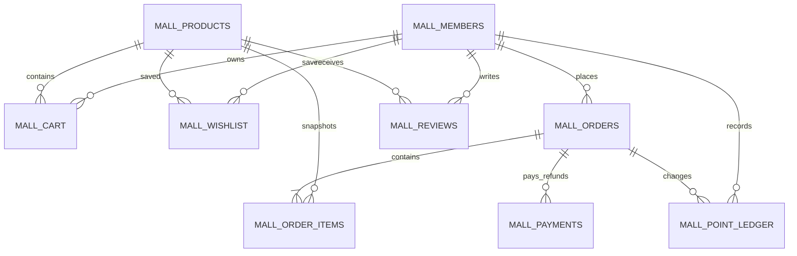

# 구현 구조 및 API

> 사이트·API 메시지·인증 메일은 일본어이며 모든 금액은 JPY 고정입니다. 별도의 통화 선택이나 통화 식별 필드는 사용하지 않습니다. [일본어/JPY 설정 안내](JAPANESE_SETUP.md)

백엔드 데이터 접근은 Spring Data JPA입니다. Entity 11개와 JpaRepository 11개를 도메인별 패키지에 배치합니다. Service에는 SQL 대신 업무 규칙·트랜잭션·Entity 변경을 두고, API는 DTO로 반환합니다. [JPA 구현 안내](JPA_STRUCTURE.md)

## 프론트엔드 / 백엔드 / DB 책임

| 기능 | Vue | Spring Boot | DB |
|---|---|---|---|
| 회원 | 로그인·가입 입력/로그아웃 | 해시/인증/세션/권한/입력 검증 | mall_members |
| 상품 | 목록·검색·정렬·상세·관리자 폼 | 공개 조회와 관리자 쓰기 분리 | mall_products |
| 장바구니·찜 | 수량·선택·합계 표시 | 계정별 접근·재고 검증 | mall_cart, mall_wishlist |
| 주문·결제 | 배송지·모의 수단·결과 | 서버 금액 계산/재고 잠금/멱등 처리 | mall_orders, mall_order_items, mall_payments |
| 포인트 | 잔액·사용·원장 | 잔액 검증/1% 적립/취소 정산 | mall_members.points, mall_point_ledger |
| 리뷰 | 상세에서 별점·내용 | 구매 여부·중복·소유자 검사 | mall_reviews |



## API 목록

모든 변경 요청은 GET /api/auth/csrf 응답의 headerName/token을 헤더에 포함합니다.
로그인 요청만 application/x-www-form-urlencoded(email,password), 나머지는 JSON입니다.
로그인/로그아웃 후 CSRF 토큰을 다시 가져옵니다. 인증은 HttpOnly 세션 쿠키입니다.

| Method | 경로 | 권한/역할 |
|---|---|---|
| GET | /api/health | 공개 상태 확인 |
| GET | /api/auth/csrf | 공개 CSRF 토큰 |
| POST | /api/auth/register | 공개, 일반 회원만 생성 |
| POST | /api/auth/email/send | 이메일 인증번호 SMTP 발송, email 입력, CSRF 필수 |
| POST | /api/auth/email/verify | email/code 확인, 같은 브라우저 세션 필요 |
| POST | /api/auth/login | 공개 로그인 |
| POST | /api/auth/logout | 세션 종료 |
| GET | /api/auth/me | 로그인 회원 정보 |
| GET | /api/products, /api/products/{id} | 공개 상품 조회 |
| POST | /api/admin/products | 관리자 등록 |
| PUT / DELETE | /api/admin/products/{id} | 관리자 수정 / 판매 중단 |
| GET / PUT | /api/cart | 내 장바구니 조회 / 상품별 절대 수량 설정 |
| DELETE | /api/cart/{productId} | 내 장바구니 상품 삭제 |
| GET | /api/wishlist | 내 찜 조회 |
| PUT / DELETE | /api/wishlist/{productId} | 내 찜 추가 / 삭제 |
| POST | /api/orders/checkout | 로그인 회원 모의 결제 |
| GET | /api/orders, /api/orders/{orderId} | 본인 주문만 |
| POST | /api/orders/{orderId}/cancel | 본인 주문 전체 취소 |
| GET | /api/points | 본인 포인트 원장 |
| GET / POST | /api/products/{productId}/reviews | 공개 조회 / 구매 회원 등록 |
| DELETE | /api/reviews/{reviewId} | 본인 리뷰 삭제 |

주문 요청 예시(가격/총액/회원 ID/권한은 클라이언트로부터 받지 않음):

```json
{
  "requestKey": "2d471823-cb20-476e-8b8e-1a9f5d513bf3",
  "pointsUsed": 0,
  "recipient": "홍길동",
  "phone": "010-1234-5678",
  "address": "서울시 테스트로 123",
  "paymentMethod": "MOCK_CARD"
}
```

paymentMethod는 MOCK_CARD 또는 MOCK_PAY만 허용합니다. 실결제 토큰이나 카드 정보를 받지 않습니다.
결제 기록 provider는 DB 제약조건에서도 MOCK으로 제한합니다.
회원별 변경은 회원 행 잠금 후 상품 ID 오름차순 잠금으로 처리합니다.

## SQL Developer에서 데이터 확인

mall 계정 → 테이블 새로고침 → MALL_로 시작하는 테이블 → 데이터 탭.
비밀번호는 해시만 저장됩니다. 실제 결제 수단 정보는 저장하지 않습니다.

```sql
SELECT id, email, name, role, points FROM mall_members;
SELECT id, name, price, stock, active FROM mall_products ORDER BY id;
SELECT id, member_id, status, subtotal, points_used, amount_paid, points_earned FROM mall_orders ORDER BY id DESC;
SELECT * FROM mall_payments ORDER BY id DESC;
SELECT * FROM mall_point_ledger ORDER BY id DESC;
```

## 수동 확인 순서

1. 관리자 환경변수로 서버 시작 → 관리자 로그인 → 상품 등록/수정/삭제
2. 이메일 발송·인증 후 일반 회원 가입 → 상품 관리 메뉴가 없으며 관리자 API 호출도 403
3. 상품 찜·장바구니 담기 → 새로고침해도 보존
4. 배송지 입력 → MOCK_CARD 주문 → 재고 감소, 장바구니 초기화, 포인트 적립
5. 다음 주문에서 포인트 사용 → 주문 내역과 마이페이지 원장 확인
6. 주문 취소 → 재고 복원, 사용 포인트 반환, 적립 회수, 모의 REFUND 기록
7. 구매 완료 상품 상세 → 리뷰 작성, 비구매자는 거절
