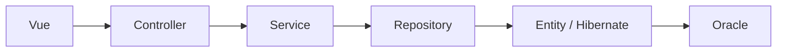

# JPA / Repository 구조

이번 변경은 DB 접근 방식을 Spring JDBC에서 Spring Data JPA로 옮긴 리팩터링입니다.
사이트의 일본어·JPY 정책, 세션 인증, API URL과 응답 필드, 기존 테이블 구조는 유지합니다.

## 파일을 읽는 순서

```text
product/
  ProductController.java   HTTP 요청/응답, 관리자 권한은 SecurityConfig에서 검사
  ProductService.java      상품 등록·수정·판매 중단 업무 규칙과 트랜잭션
  ProductRepository.java   JpaRepository, 조회 메서드 및 잠금 쿼리
  ProductEntity.java       @Entity / @Table / @Column로 DB 매핑
  Product.java             화면에 반환하는 record DTO
```



## Entity와 응답 DTO

`ProductEntity`는 `mall_products`에 매핑됩니다. `@Entity`, `@Table`, `@Column`과 공통 ID의 `@Id`, `@GeneratedValue(IDENTITY)`가 매핑을 정의합니다.
`Product` record는 기존 API 응답을 유지하는 DTO이므로 Entity 어노테이션이 없습니다.
비밀번호 해시·내부 연관관계가 외부에 노출되지 않도록 모든 컨트롤러는 Entity가 아닌 DTO를 반환합니다.
Lombok은 사용하지 않으며 생성자·getter·setter는 일반 Java 코드로 작성했습니다.

## Repository

기본 CRUD는 `JpaRepository`에서 제공하는 `save`, `findById`, `delete`, `count` 등을 사용합니다.
조건 조회는 `findByIdAndActive`, `findByEmail` 같은 메서드로 표현합니다.
잠금·DTO 프로젝션이 필요한 조회만 Repository의 `@Query`에 **JPQL**을 작성합니다.
JPQL은 DB 테이블/컬럼명이 아니라 `ProductEntity` 같은 Entity와 Java 필드명을 기준으로 작성합니다.
운영 Service에는 직접 SQL, JdbcTemplate, RowMapper가 없습니다.

## 트랜잭션과 변경 감지

조회용 Service는 기본 `@Transactional(readOnly=true)`이고, 변경 메서드에는 `@Transactional`을 지정합니다.
트랜잭션에서 조회한 관리 상태 Entity를 수정하면 커밋할 때 Hibernate의 변경 감지로 UPDATE가 실행됩니다.
새 데이터는 Repository로 저장하며, DB 제약조건을 즉시 확인해야 하는 지점은 `saveAndFlush`를 사용합니다.

## 연관관계와 잠금

- 주문 → 회원, 주문상품 → 주문/상품, 리뷰 → 회원/상품 등을 `@ManyToOne(fetch=LAZY)`로 매핑
- 장바구니/찜은 `@EmbeddedId`와 `@MapsId`로 기존 복합키를 유지
- 회원·상품 잠금은 Repository의 `@Lock(PESSIMISTIC_WRITE)` 사용
- 주문 처리 시 회원을 먼저 잠그고 상품 ID 오름차순으로 잠금
- 장바구니 조회는 스칼라 DTO 프로젝션으로 반환하여 상품 잠금 전에 오래된 재고 Entity가 영속성 컨텍스트에 들어오지 않도록 처리
- 주문 목록은 주문 목록과 상품 스냅샷을 일괄 조회하여 주문별 추가 조회를 피함
- 리뷰 작성자와 포인트 주문 연관은 필요한 조회에서 EntityGraph로 가져옴
- 이메일 인증의 오입력/재발송 제한은 실패 시에도 커밋하며, 가입 시 인증 소비는 회원 저장과 함께 롤백

`open-in-view=false`이므로 DTO 변환은 서비스 트랜잭션 안에서 끝납니다.

## 기존 Oracle DB와 호환

```yaml
spring:
  jpa:
    open-in-view: false
    hibernate:
      ddl-auto: validate
```

Hibernate는 테이블과 컬럼을 검사만 합니다. JPA 전환을 위해 기존 데이터를 삭제하거나 스키마를 재생성하지 않습니다.
기존 `NUMBER(19)`, `NUMBER(10)`, `CLOB`, `TIMESTAMP` 타입에 맞춰 Entity를 매핑했습니다.
최초 스키마 생성과 실제 구조 변경용 SQL은 계속 필요합니다. `validate`가 테이블을 생성해 주지는 않습니다.
IntelliJ에서 Maven Reload 후 기존 DB/메일 환경변수로 재시작하면 됩니다. 별도 Entity/Lombok 플러그인 설정은 필요하지 않습니다.

## 검증

통합 테스트는 H2 Oracle 호환 모드의 기존 SQL 스키마를 먼저 만든 후, **JPA 스키마 검증을 켠 상태**에서 실행합니다.
동시 주문의 마지막 재고, 중복 요청, 저장 실패 롤백, 포인트 사용·환급, 주문 소유권, 관리자 권한, 이메일 인증 횟수·만료·발송 실패를 확인합니다.
테스트의 JdbcTemplate은 결과를 JPA와 독립적으로 확인하거나 DB 제약조건 실패를 주입하기 위해 남겨 두었습니다.
실제 Oracle 서버의 접속 및 메타데이터 검증은 해당 서버에서 별도로 확인해야 합니다.

참고 문서:
- https://docs.spring.io/spring-data/jpa/reference/jpa/locking.html
- https://docs.spring.io/spring-boot/how-to/data-initialization.html
